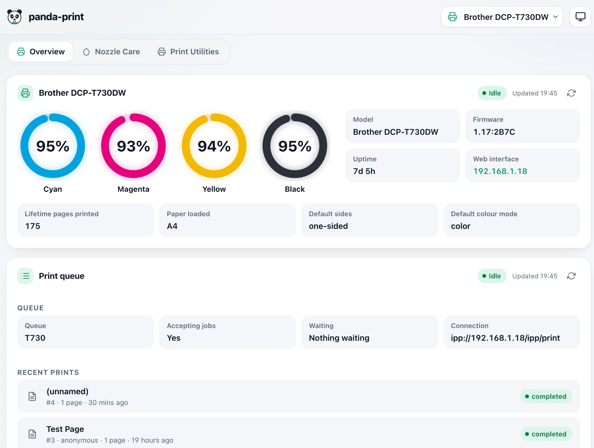
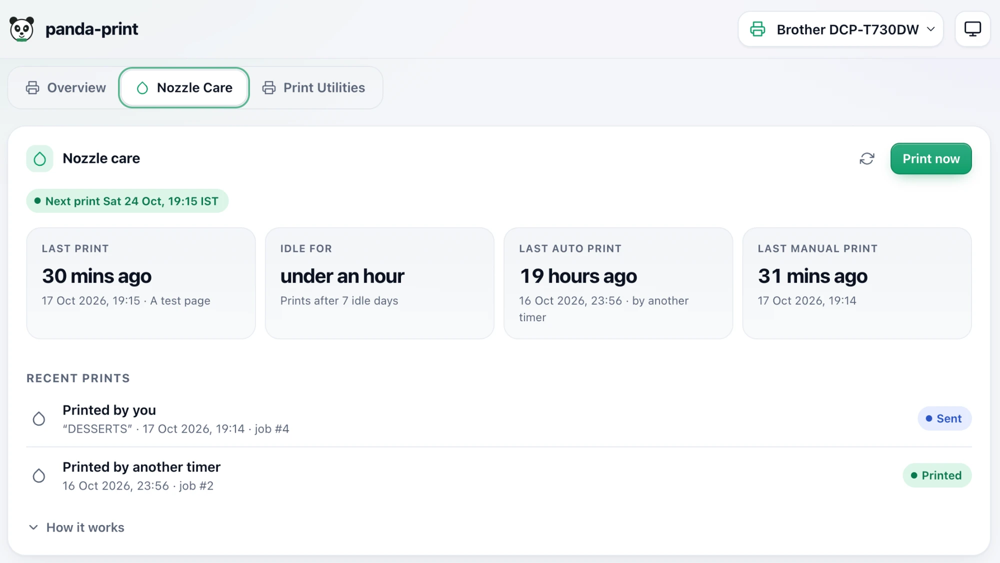
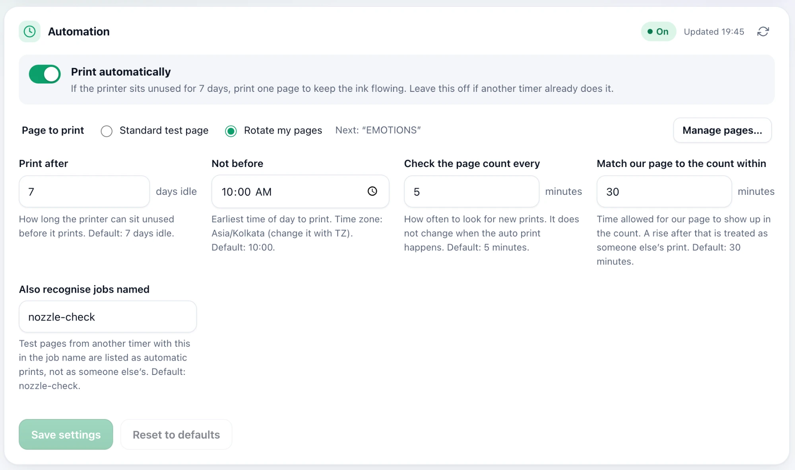
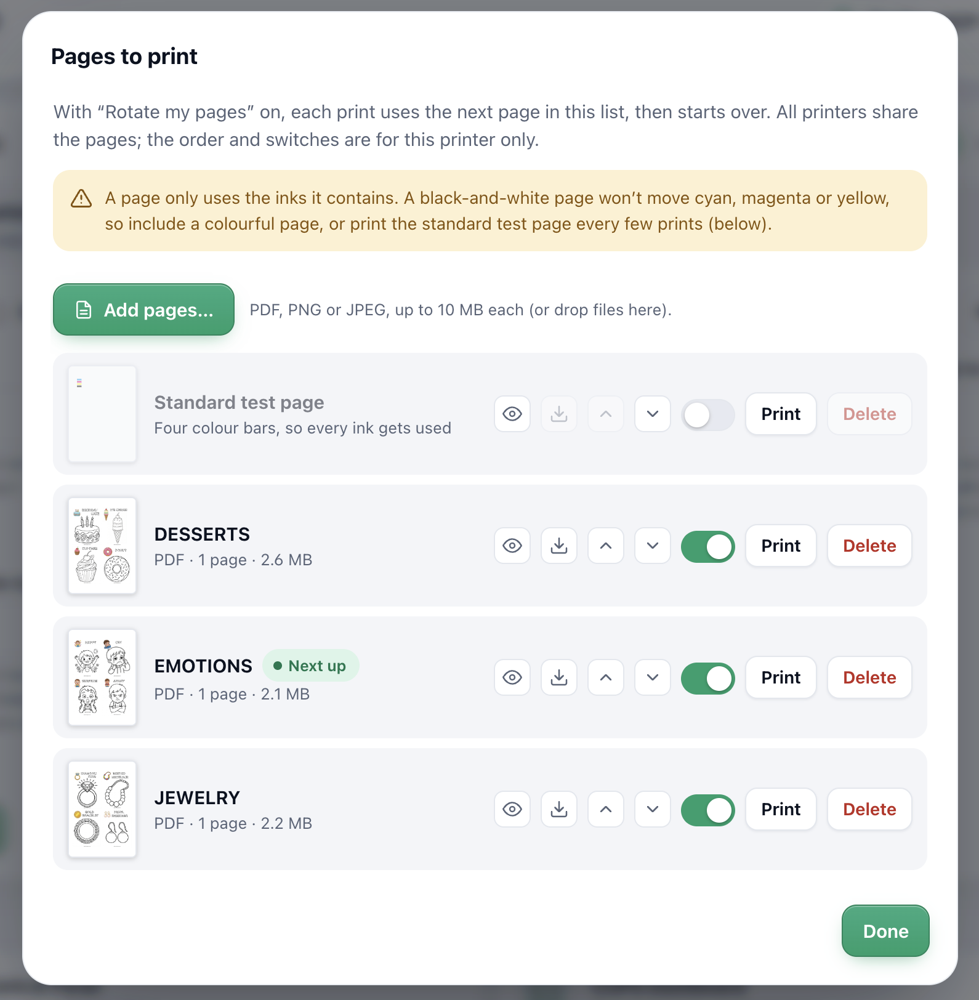

# panda-print

[](https://github.com/tusharkaurani/panda-print/actions/workflows/build.yml)
[](LICENSE)

A small, self-hosted dashboard for your home printer. See ink levels and page counts at a glance, and let it print a page now
and then, so the nozzles of an inkjet don't clog when it sits unused. Runs in Docker on a Raspberry Pi or any Linux box, and
needs about 40 MB of memory.


*Overview: live ink levels, page count and the print queue.*


*Nozzle Care: when the printer last printed, and a **Print now** button that previews the page first.*


*Automation: print by itself when the printer has been idle, at a time of day you choose.*


*Pages to print: use colouring pages or worksheets instead of a test pattern, and print multi-page files on both sides.*

## Features

- **Status at a glance:** ink levels, state, lifetime page count and printer details, with a clear **Offline** view that keeps the last known values when the printer is off.
- **Automatic nozzle care:** when a printer has sat idle for N days, it prints one page, only after a time of day you set. Off by default.
- **Pages worth printing:** rotate through your own PDFs, PNGs and JPEGs (colouring pages, worksheets) instead of colour bars, with real previews. Multi-page files can print on both sides on printers that flip the paper by themselves.
- **Print now:** shows the page that will print first, then asks you to confirm.
- **Several printers:** add as many as you like, each with its own settings and history. A first-run wizard finds your printer on the network.
- **Passport Sheet Maker** (inside Print Utilities): lay out copies of one or several edited passport or ID photos at an exact size (mm, cm or inches) on the paper you choose, with per-photo cropping, the option to use only half of the paper, a live preview that stays in view, and presets for the jobs you repeat, then download a PDF or print it at actual size with the paper type and quality your printer offers.
- **Label Sheet Maker** (inside Print Utilities): put names, addresses or any text on the labels of an Avery-style pack or a plain sheet of stickers, typed or from a spreadsheet (CSV), styled with shapes, colours, borders, fonts and a logo, with presets, a live preview, a part-used-sheet start, then download a PDF or print it at actual size.
- **Photo Collage Sheet** (inside Print Utilities): choose any number of photos and they are fitted onto one sheet by halving the paper (A4 is two A5, A5 is two A6), each photo placed where its shape fits best, with other arrangements to try, a tap-to-swap preview, per-photo crop, half-page printing, and presets, then download a PDF or print it at actual size.
- **Quick links and Print Utilities:** links to each printer's own pages, plus a Print Utilities tab with the built-in photo tool and links to free online tools (passport photos, worksheets, calendars, posters).
- **Careful by design:** no cloud, no CDN, no accounts. Printing is rate-limited and requests are CSRF-protected. Light and dark themes, and a phone-friendly layout.

## Quick start (Docker)

On the machine that runs CUPS, for example a Raspberry Pi:

```bash
mkdir -p ~/panda-print/config && cd ~/panda-print
curl -fsSL https://raw.githubusercontent.com/tusharkaurani/panda-print/main/compose.example.yml -o compose.yml
curl -fsSL https://raw.githubusercontent.com/tusharkaurani/panda-print/main/config/links.yml -o config/links.yml
docker compose up -d
```

Open `http://<that machine>:8095`. The first visit starts a setup wizard that finds your printer. The image is
`ghcr.io/tusharkaurani/panda-print` (amd64 and arm64). To update: `docker compose pull && docker compose up -d`.

There is no login, so put it behind a reverse proxy with single sign-on if it is reachable beyond your home network.

## What you need

- A network printer that answers **IPP** and **SNMP** (most do). Verified on a Brother DCP-T730DW; others should work but are untested.
- **CUPS is optional.** Without it you still get status, ink levels and page counts. CUPS adds the print queue, recent jobs, **Print now**, automatic printing and your own pages. It can run on the same machine or elsewhere on your network.

## Documentation

| | |
|---|---|
| [Install and set up](docs/install.md) | Docker details, the setup wizard, behind a proxy |
| [Configuration](docs/configuration.md) | environment variables, quick links, the Print Utilities list |
| [Features in detail](docs/features.md) | CUPS or not, automatic printing, pages and both-sides, offline printers, several printers |
| [How it works](docs/how-it-works.md) | how prints are noticed, the security model, known limits |
| [Development](docs/development.md) | run it locally, tests, adding your own tool, project layout |

## Contributing and license

Contributions are welcome: see [CONTRIBUTING.md](CONTRIBUTING.md). Report security problems as described in [SECURITY.md](SECURITY.md).

MIT licensed, see [LICENSE](LICENSE). Third-party software and trademarks are listed in [THIRD-PARTY.md](THIRD-PARTY.md).
panda-print is not affiliated with Brother, the CUPS project or any site it links to.
